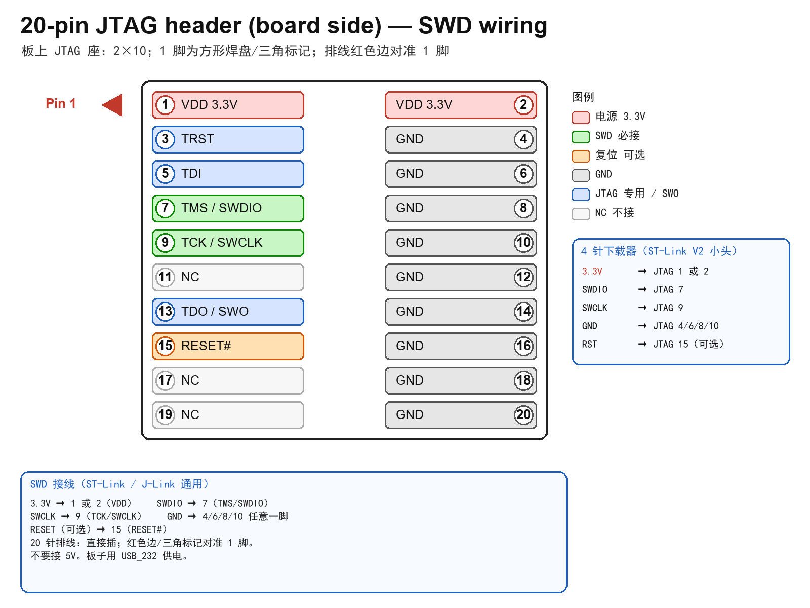
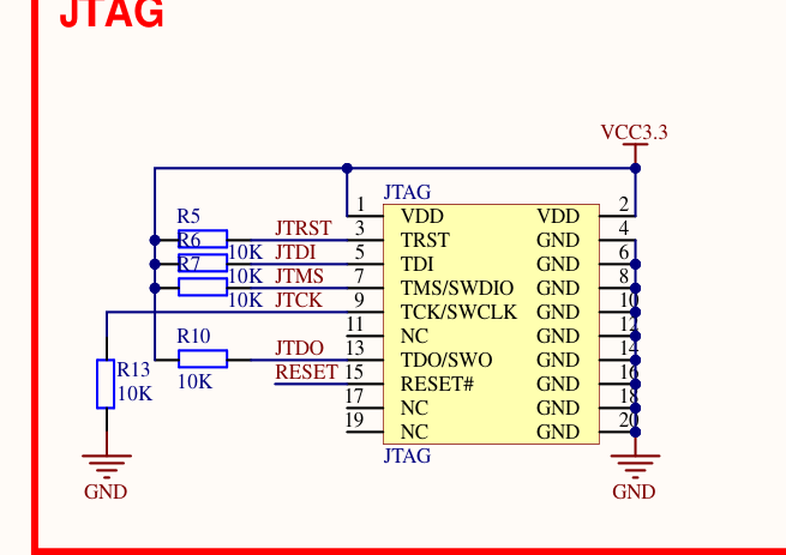
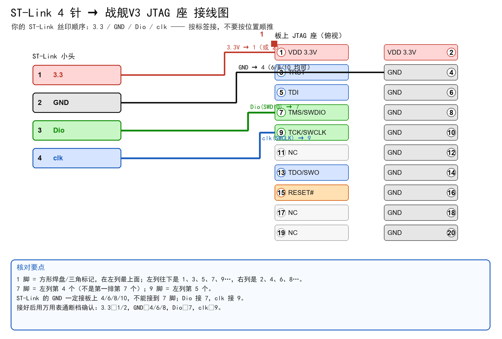

# ST-Link / J-Link 接线（战舰V3 20 脚 JTAG 座）

> 板载接口：2×10 标准 20 脚 JTAG 排针，丝印 `JTAG`。1 脚为方形焊盘/三角标记；20 针排线的红色边对准 1 脚。
> ST-Link 与 J-Link 的 **SWD 接线完全相同**，只是 Keil 里选的调试器不同。

## 0. 本机 ST-Link 的 4 针小头（丝印 3.3 / GND / Dio / clk）

> 注意：这个顺序不是常见的 `3.3/SWDIO/SWCLK/GND`。必须按丝印接，不能按位置顺推。

| ST-Link 丝印 | 接到板上 JTAG 脚 |
|---|---|
| 3.3 | 1 或 2（VDD） |
| GND | 4 / 6 / 8 / 10 任意一脚 |
| Dio（SWDIO） | 7（TMS/SWDIO） |
| clk（SWCLK） | 9（TCK/SWCLK） |

## 1. 板载 JTAG 座针脚定义

| 脚 | 信号 | SWD 用途 |
|---|---|---|
| 1 | VDD（3.3V） | 3.3V 参考 |
| 2 | VDD（3.3V） | 3.3V 参考 |
| 3 | TRST | 不用 |
| 4 | GND | 地 |
| 5 | TDI | 不用（JTAG） |
| 6 | GND | 地 |
| **7** | **TMS/SWDIO** | **SWD 数据** |
| 8 | GND | 地 |
| **9** | **TCK/SWCLK** | **SWD 时钟** |
| 10 | GND | 地 |
| 11 | NC | 不接 |
| 12 | GND | 地 |
| 13 | TDO/SWO | 可选（SWO 调试输出） |
| 14 | GND | 地 |
| **15** | **RESET#** | 可选复位 |
| 16 | GND | 地 |
| 17 | NC | 不接 |
| 18 | GND | 地 |
| 19 | NC | 不接 |
| 20 | GND | 地 |

## 2. 4 针/5 针下载器接线

| 下载器引脚 | 接到板上 JTAG 脚 |
|---|---|
| 3.3V | 1 或 2（VDD） |
| SWDIO | 7（TMS/SWDIO） |
| SWCLK | 9（TCK/SWCLK） |
| GND | 4/6/8/10 任意一脚 |
| RST（可选） | 15（RESET#） |

- **不要接 5V**；板子用 USB_232 供电。
- 只用 SWD 时，TDI、TRST、TDO 可以不接。
- 如果下载器是 10 针（2×5）小头，先确认其丝印：不同厂家排列不同，按“3.3V/SWDIO/SWCLK/GND/RST”标签对应到上表。

## 3. 20 针排线

- 直接插到板上 `JTAG` 座。
- 排线红色边 / 连接器三角标记对准板上 1 脚。
- 插反可能让 3.3V 与 GND 错位，**插之前一定核对 1 脚**。

## 4. Keil 设置

1. `Options for Target` → `Debug`：
   - ST-Link：选 `ST-Link Debugger`。
   - J-Link：选 `J-Link / J-Trace Cortex`。
2. `Settings` → `Port` 选 **SW**，`Max Clock` 先选 **1.8 MHz**。
3. `Flash Download` 确认有 `STM32F10x 512KB Flash` 算法。
4. `Utilities` → 勾选 `Use Target Driver for Flash Programming`，选择对应下载器。
5. `F8` 下载；`Ctrl+F5` 进入调试。

## 5. 识别不到芯片时

1. 确认板子已上电（USB_232）。
2. 确认 3.3V、SWDIO、SWCLK、GND 四根线没有接错/虚接。
3. 把 `Max Clock` 降到 1 MHz。
4. 检查 PA13/PA14 是否被其他代码复用（本工程只关 JTAG、保留 SWD，未占用 PA13/PA14）。
5. 用万用表确认板上 JTAG 的 1/2 脚为 3.3V、4/6/8 脚为 GND。
